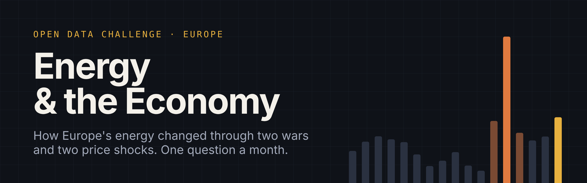

# Energy & the Economy

**A free, friendly data challenge about Europe's energy: what it costs, where it comes from, who pays and how fast it's changing.**

Energy touches everything. When gas and oil get expensive, heating bills, food, transport and factory goods all
follow, and governments scramble to help. Since 2010 Europe has lived through two energy shocks: Russia's invasion of
Ukraine in 2022, then war in the Gulf in 2026. In between, the way Europe makes its electricity changed faster than
almost anyone expected.

This project does two things:

1. **It answers questions.** The [State of Europe's energy](findings/README.md) report has eleven findings, each with
   charts and a plain-English explanation. It redraws itself when new figures come out.
2. **It asks you questions.** Each month there's a new challenge. Dig into the data, make something and share it.
   No sign-up and no gatekeeping. Beginners are very welcome.

> 📈 **Every chart here is drawn with [bezel-charts](https://pypi.org/project/bezel-charts/), an open-source Python
> library created by Shaz Moghaddam, the author of this project.** It turns pandas data into clean, self-contained
> SVG charts in one line. `pip install bezel-charts` · [PyPI](https://pypi.org/project/bezel-charts/) ·
> [GitHub](https://github.com/ShazMoghaddam/bezel-charts)

---

## Right now

<!-- tiles:start -->
<p align="center">
  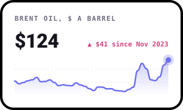
  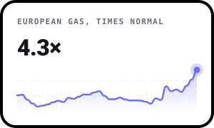
  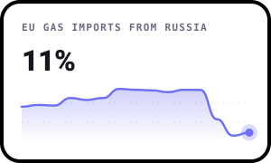
</p>

<p align="center">
  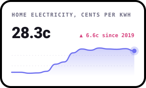
  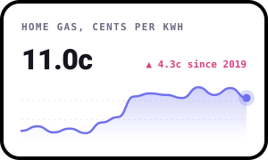
  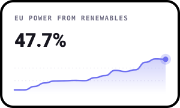
</p>
<!-- tiles:end -->

*The latest figures, with the story behind them. Updated from Eurostat, FRED and Our World in Data.*

---

## Key findings

<!-- key-findings:start -->
### Russia went from supplying 41% of the EU's imported gas to 11%

In 2021 Russia was the EU's biggest gas supplier. By 2024 the volume was down 75%, replaced
mostly by Norway and American LNG, and a full ban starts in 2027.

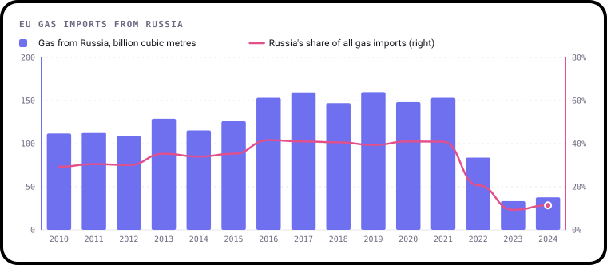

### Gas cost 11.8 times its normal price in Aug 2022

Then, in 2026, war in the Gulf sent oil to **$138** a barrel on 7 April. It averaged **$124** in Oct 2026.

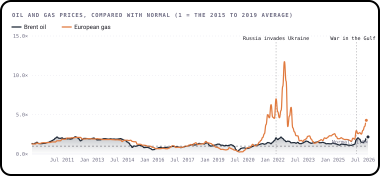

### Countries that relied on Russian gas didn't see bigger bills

There's almost no link (r = 0.03) between how much gas a country bought from Russia and how much household gas
prices rose. Europe shares one market, so prices rose everywhere.

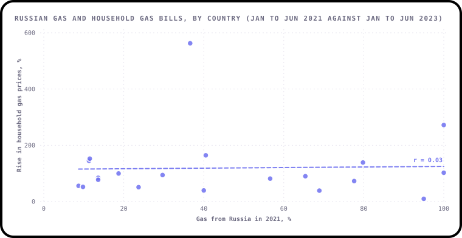

### Wind now makes more of the EU's electricity than gas, and solar more than coal

Renewables made 48% of the EU's electricity in 2025. Since 2021, solar
power has grown by 204 TWh while coal fell by 162 TWh.

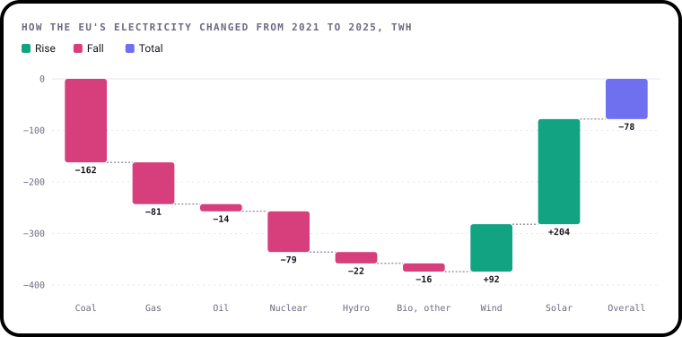
<!-- key-findings:end -->

**[Read all eleven findings in the State of Europe's energy report →](findings/README.md)**

| # | Finding | |
|---|---|---|
| 1 | The headline numbers | Oil, gas, household bills, Russian gas and renewables at a glance |
| 2 | What normal looked like | Europe's electricity from 2010 to 2021, and the risk that was building |
| 3 | Russia's gas | From the EU's biggest supplier to a legal ban, and who filled the gap |
| 4 | The 2022 price shock | How far gas and oil prices rose above normal, and why gas rose so much more |
| 5 | The second shock | War in the Gulf in 2026, the Strait of Hormuz and Europe's empty gas stores |
| 6 | What households pay | Electricity and gas bills since 2010, country by country |
| 7 | Did Russian gas decide who paid most? | A surprising answer: not really |
| 8 | Europe used less gas | The 15% goal, and which countries cut the most |
| 9 | The switch to clean power | Wind overtakes gas, solar overtakes coal |
| 10 | What governments and the EU did | €651 billion of support, price caps and windfall taxes |
| 11 | The big energy companies | Record profits in 2022, and what came after |

---

## This month

### January 2027: Two shocks

**The question:** Was the 2026 war in the Gulf as big a shock for Europe as Russia's invasion of Ukraine in 2022?

In 2022 the problem was gas: it cost nearly twelve times its normal price at the peak. In 2026 the problem started
with oil, as the Strait of Hormuz closed, then spread to gas as Qatar's exports stopped. Which hit harder, who
felt it, and what's different this time?

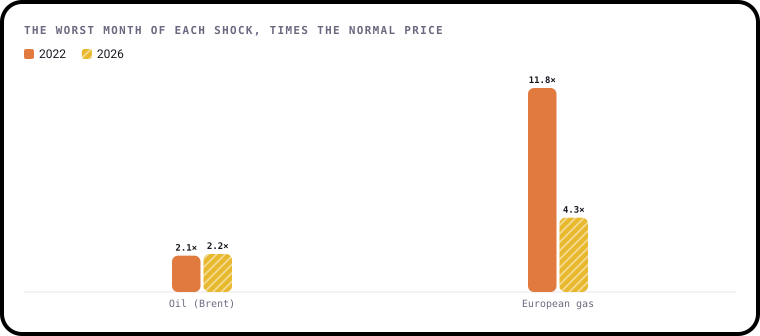

**Runs:** 1 to 31 January 2027
**Full brief:** [challenges/2027-01-two-shocks](challenges/2027-01-two-shocks/README.md)

| Level | What you'll do |
|---|---|
| 🟢 Beginner | Chart oil and gas prices in 2022 and 2026 and say which shock was bigger |
| 🟡 Intermediate | Compare the two shocks for households: prices, gas use and storage |
| 🔴 Expert | Bring in another dataset, such as inflation or industrial output, and test an idea |

---

## How it works

1. **Read the brief** for this month in the [`challenges`](challenges/) folder.
2. **Get the data.** It's already in this repo in [`data/`](data/). Run `python3 data/fetch.py` to download the very
   latest from Eurostat, FRED and Our World in Data.
3. **Make something.** Python, R, Excel, Tableau, pen and paper scanned in: anything goes.
4. **Share it.** Fork this repo, add a folder at `submissions/2027-01/your-github-username/` with a short
   `README.md` (use the [template](SUBMISSION_TEMPLATE.md)), then open a pull request.

New to GitHub? [CONTRIBUTING.md](CONTRIBUTING.md) walks you through it step by step.

### Run it yourself

```bash
git clone https://github.com/ShazMoghaddam/europe-energy-economy.git
cd europe-energy-economy
pip3 install -r requirements.txt
python3 data/fetch.py        # download the latest figures
python3 findings/build.py    # redraw every chart and rewrite the report
```

Every chart is drawn with [bezel-charts](https://pypi.org/project/bezel-charts/), a small open-source Python
library by the same author, Shaz Moghaddam. It also comes as web components for websites:
[github.com/ShazMoghaddam/bezel-charts](https://github.com/ShazMoghaddam/bezel-charts).

---

## What's coming up

Each month takes one part of Europe's energy story and goes deeper.

| Month | Question | Extra data |
|---|---|---|
| **Jan 2027** | **Two shocks.** Was 2026 as bad as 2022? | Daily and monthly oil and gas prices |
| Feb 2027 | **Who pays?** Household bills across Europe, and what governments did about them | Eurostat household prices |
| Mar 2027 | **Life after Russian gas.** Who replaced it, and at what cost? | Eurostat gas imports by partner |
| Apr 2027 | **The solar surge.** Where it's growing fastest, and what's holding it back | Our World in Data, from Ember |
| May 2027 | **Windfall.** Who profited from high prices, and what did they do with it? | Company results |

The order may change. Vote in [Discussions](https://github.com/ShazMoghaddam/europe-energy-economy/discussions) or
[suggest an idea](https://github.com/ShazMoghaddam/europe-energy-economy/issues/new?template=idea-suggestion.yml).

Working on the UK too? The sister projects, [Jobs & the Economy](https://github.com/ShazMoghaddam/uk-jobs-economy)
and [House Prices & the Economy](https://github.com/ShazMoghaddam/uk-house-prices-economy), use the same format.

---

## Key ideas in plain English

| Word | What it means |
|---|---|
| **kWh** | A kilowatt-hour: the unit on your energy bill. A 1 kW heater running for an hour uses one |
| **TWh** | A terawatt-hour, a billion kWh. Used for whole countries |
| **Billion cubic metres** | How gas is measured when it's bought and sold between countries. The EU used about 340 of them in 2025 |
| **Brent** | The main price for oil in Europe, in US dollars a barrel |
| **TTF** | The main wholesale gas market in Europe, based in the Netherlands |
| **LNG** | Liquefied natural gas: gas cooled until it turns to liquid, so it can be shipped by sea |
| **Renewables** | Energy that doesn't run out: wind, solar, hydro and bioenergy |
| **Low-carbon** | Renewables plus nuclear: electricity made without burning fossil fuels |
| **Gas storage** | Underground stores countries fill in summer to get through the winter |
| **Windfall tax** | An extra tax on profits that came from luck, like a sudden jump in prices, rather than effort |
| **"Times normal"** | A price compared with its 2015 to 2019 average. 2 means twice as expensive as normal |
| **r** | A number from −1 to 1 that measures how closely two things move together. 0 means no link |

---

## Gallery

The best entries each month are featured here.

### January 2027
*Be the first. Submissions open 1 January.*

---

## Join the conversation

Head to [Discussions](https://github.com/ShazMoghaddam/europe-energy-economy/discussions) to share early findings, ask
questions, give feedback on other people's work and vote on what comes next.

---

## Data and licences

| Source | Licence |
|---|---|
| [Eurostat](https://ec.europa.eu/eurostat) | [CC BY 4.0](https://ec.europa.eu/eurostat/about-us/policies/copyright), © European Union |
| [Our World in Data](https://github.com/owid/energy-data), from Ember and the Energy Institute | [CC BY 4.0](https://creativecommons.org/licenses/by/4.0/) |
| [U.S. Energy Information Administration](https://www.eia.gov/) (Brent oil), via [FRED](https://fred.stlouisfed.org/) | Public domain |
| [International Monetary Fund](https://www.imf.org/en/Research/commodity-prices) (European gas), via [FRED](https://fred.stlouisfed.org/) | Free to use with credit |
| Company results, news and policy sources | Linked next to each figure in [`data/company_profits.csv`](data/company_profits.csv), [`data/timeline.csv`](data/timeline.csv) and [`data/facts.json`](data/facts.json) |

[`data/sources.json`](data/sources.json) records where every file came from and when it was downloaded.

Code and content in this repo are [MIT licensed](LICENSE). By submitting a pull request you agree to share your
entry under the same licence.

---

Created by **Shaz Moghaddam** · London
[Website](https://shazmoghaddam.github.io) · [LinkedIn](https://www.linkedin.com/in/shazmoghaddam)
