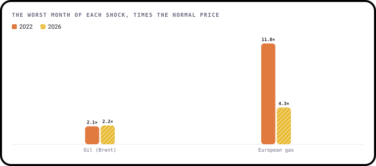
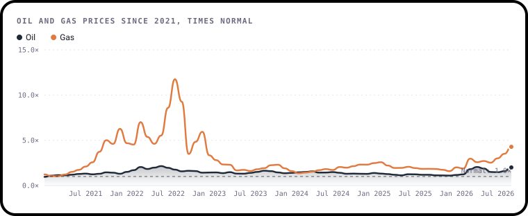

# January 2027: Two shocks

**The question:** Was the 2026 war in the Gulf as big a shock for Europe's energy as Russia's invasion of Ukraine in 2022?

**Runs:** 1 to 31 January 2027
**Data:** Monthly oil and gas prices to October 2026, daily oil prices to early November 2026, plus household prices,
gas use and imports from Eurostat. It's all already in this repo.

---

## The story so far

Prices in this brief are compared with **normal**: their average from 2015 to 2019. A price of 2× normal means energy
cost twice what it used to.

**2022: a gas shock.** Russia had been the EU's biggest gas supplier. When it invaded Ukraine and cut supplies,
European gas went from expensive to extraordinary. In **August 2022** it cost **11.8 times** its normal price. Oil
rose too, but only to about **2.2 times** normal at its worst, in June 2022.

**2026: an oil shock first.** On 28 February 2026 the United States and Israel struck Iran, and shipping through the
Strait of Hormuz nearly stopped. About a fifth of the world's oil normally passes through it. Brent oil averaged
**$124 a barrel in October 2026**, 2.2 times normal and its highest monthly average since 2012, before allowing for inflation.
Gas rose too, once Qatar's exports stopped, but less than in 2022: **4.3 times** normal at its worst so far, in
September 2026.



So is 2026 the smaller shock? Not so fast. Gas prices are a third of their 2022 peak, but Europe went into 2026 with
its gas stores unusually empty. Oil, which hardly moved in 2022, is now as expensive as it has been in years. And
household bills only show the first half of 2026 so far. That's what makes it a good question.



*Both charts are made from this repo's data by [`make_charts.py`](make_charts.py), with
[bezel-charts](https://pypi.org/project/bezel-charts/), an open-source Python library created by Shaz Moghaddam,
who runs this challenge.*

---

## Get the data

It's already in this repo, so you don't need to download anything. Run `python data/fetch.py` for the very
latest figures, and see [`data/sources.json`](../../data/sources.json) for where each file came from.

| File | What's in it |
|---|---|
| [`world_prices.csv`](../../data/world_prices.csv) | One row per month: `brent_usd_per_barrel` (oil) and `eu_gas_usd_per_mmbtu` (European gas, Dutch TTF) |
| [`brent_daily.csv`](../../data/brent_daily.csv) | One row per trading day: the Brent oil price |
| [`household_prices.csv`](../../data/household_prices.csv) | What households pay per kWh, every half year, by country. `S1` is January to June |
| [`gas_consumption.csv`](../../data/gas_consumption.csv) | How much gas each country used each month, in million cubic metres |
| [`timeline.csv`](../../data/timeline.csv) | The key events of both shocks, with a source for each |

**Units in plain English:** oil is in US dollars a barrel (159 litres). Gas is in US dollars per million British
thermal units (MMBtu), a standard trading unit. You don't need to convert anything: comparing with normal, or
comparing 2022 with 2026, works in any unit.

---

## Pick your level

### 🟢 Beginner
Put 2022 and 2026 side by side.
- Chart the oil price, or the gas price, month by month in both years
- Mark the start of each war
- In one or two sentences: which shock was bigger for that fuel?

### 🟡 Intermediate
Pick one question:
- Use `brent_daily.csv` to count the days oil cost over $100 in 2022 and in 2026. Which year had more?
- How fast did each shock reach household bills? Compare `household_prices.csv` in the half-years after each war began.
- Did Europe cut its gas use in 2026 the way it did in 2022? Look at `gas_consumption.csv` month by month.
- Gas or oil: which matters more for European households, and why?

### 🔴 Expert
Bring in one more piece of data and test an idea. For example:
- **Inflation.** Eurostat publishes [consumer price inflation](https://ec.europa.eu/eurostat/web/hicp) for every EU
  country, including energy on its own. How much of each shock showed up in the shops?
- **Industry.** Eurostat's [industrial production](https://ec.europa.eu/eurostat/web/short-term-business-statistics)
  figures show what happened to factories. Were energy-hungry industries like chemicals hit harder in 2022 or 2026?
- **Adjusting for inflation.** A dollar in 2026 buys less than in 2012. Does October 2026 still look like a record
  once you allow for that?

Explain what you find in plain language. A clear finding beats a complicated model, and saying what your data
can't prove is a strength, not a weakness.

---

## Starter code

A small Python script, [`starter.py`](starter.py), gets you going. From the top of the repo, in Terminal on a Mac:

```bash
pip3 install -r requirements.txt
python3 challenges/2027-01-two-shocks/starter.py
```

It prints a quick summary and saves two charts as SVG files, which open in any browser:

```
Brent oil ($ a barrel)
  2022: highest 122.71 in June, average 100.78 over 12 months
  2026: highest 123.93 in October, average 96.34 over 10 months
European gas ($ per million British thermal units)
  2022: highest 69.98 in August, average 37.52 over 12 months
  2026: highest 25.49 in September, average 16.87 over 9 months
Saved oil-2022-vs-2026.svg and gas-2022-vs-2026.svg. Open them in your browser.
```

The charts are drawn with [bezel-charts](https://pypi.org/project/bezel-charts/), but use whatever you like:
matplotlib, Excel, Tableau or pen and paper all work.

---

## Share your work

Put your work in `submissions/2027-01/your-github-username/` with a `README.md` based on the
[submission template](../../SUBMISSION_TEMPLATE.md), then open a pull request. [CONTRIBUTING.md](../../CONTRIBUTING.md)
has step-by-step help.

Credit the data like this:

> Sources: Eurostat (CC BY 4.0); U.S. Energy Information Administration and International Monetary Fund, via FRED.

---

Created by **Shaz Moghaddam** · London
[Website](https://shazmoghaddam.github.io) · [LinkedIn](https://www.linkedin.com/in/shazmoghaddam)
