# State of Europe's energy

**From 2010 to Oct 2026: two wars, two price shocks, and a power system that changed faster than anyone expected.**

Every number and chart on this page is worked out from the data in [`data/`](../data) by [`build.py`](build.py), and
redrawn when new figures come out. Charts are drawn with [bezel-charts](https://pypi.org/project/bezel-charts/), an
open-source Python library created by Shaz Moghaddam, the author of this project.

Data last downloaded: 2026-11-11 19:14 UTC.

**In this report:** [1. The headline numbers](#1-the-headline-numbers) ·
[2. What normal looked like](#2-what-normal-looked-like-2010-to-2021) ·
[3. Russia's gas](#3-russias-gas-from-biggest-supplier-to-almost-gone) ·
[4. The 2022 price shock](#4-the-2022-price-shock) ·
[5. The second shock: war in the Gulf](#5-the-second-shock-war-in-the-gulf-2026) ·
[6. What households pay](#6-what-households-pay) ·
[7. Did Russian gas decide who paid most?](#7-did-russian-gas-decide-who-paid-most) ·
[8. Europe used less gas](#8-europe-used-less-gas) ·
[9. The switch to clean power](#9-the-switch-to-clean-power) ·
[10. What governments did](#10-what-governments-and-the-eu-did) ·
[11. The big energy companies](#11-the-big-energy-companies) ·
[About the data](#about-the-data)

## 1. The headline numbers

  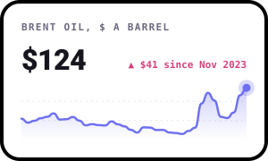
  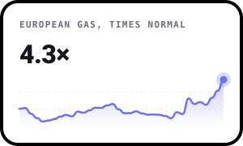
  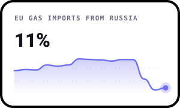

  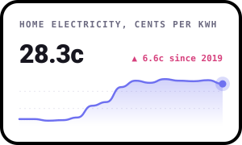
  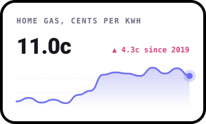
  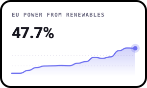

Each tile shows the latest figure, with the line behind it.

- **Oil** averaged **$124** a barrel in Oct 2026, 2.2 times its 2015 to 2019 average.
- **Russia** supplied **41%** of the gas the EU imported in 2021. By 2024 it was **11%**.
- **Households** paid **28.3 cents** per kWh for electricity in Jan to Jun 2026, up 29% on Jan to Jun 2021.
- **Renewables** made **48%** of the EU's electricity in 2025, against 22% in 2010.

## 2. What normal looked like (2010 to 2021)

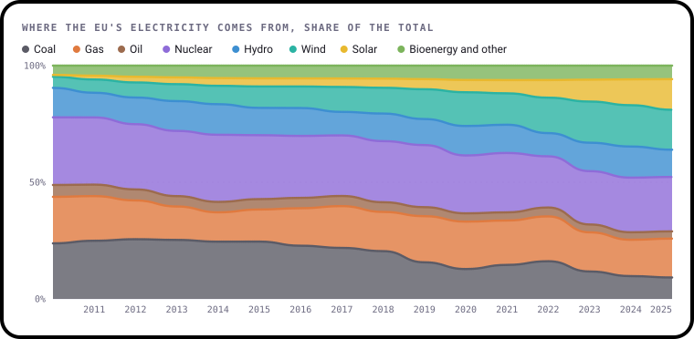

In 2010, **49%** of the EU's electricity came from burning coal, gas and oil. Wind and solar
together made just **5.5%**. Nuclear power, half of it made in France, provided **29%**.

For most of the 2010s the picture changed slowly. Wind and solar grew a little every year, coal slipped, and
energy was cheap: oil and gas prices in 2015 to 2019 are the "normal" that the rest of this report compares against.

Underneath, though, a risk was building. The EU's own gas fields were running down. Gas production fell from
**1,256 TWh** in 2010 to **443 TWh** in 2021, as the giant
Groningen field in the Netherlands was wound down after earthquakes. More and more gas had to be bought from abroad,
and the cheapest, closest seller was Russia.

## 3. Russia's gas: from biggest supplier to almost gone

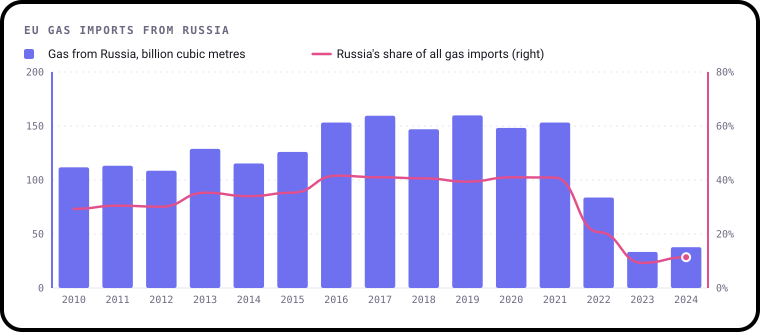

- In 2019, the EU bought **160 billion cubic metres** of gas from Russia.
  In 2021, Russia supplied **41%** of all the gas the EU imported from outside the EU.
- By 2024 that share had fallen to **11%**, and the volume was down
  **75%** on 2021.
- The European Commission, which also counts Russian gas that reaches Europe through other countries and as
  liquefied natural gas (LNG) shipped by sea, puts the fall at **45% to 19%**
  between 2021 and 2024, and about **13%** in 2025.

Some countries were far more exposed than others:

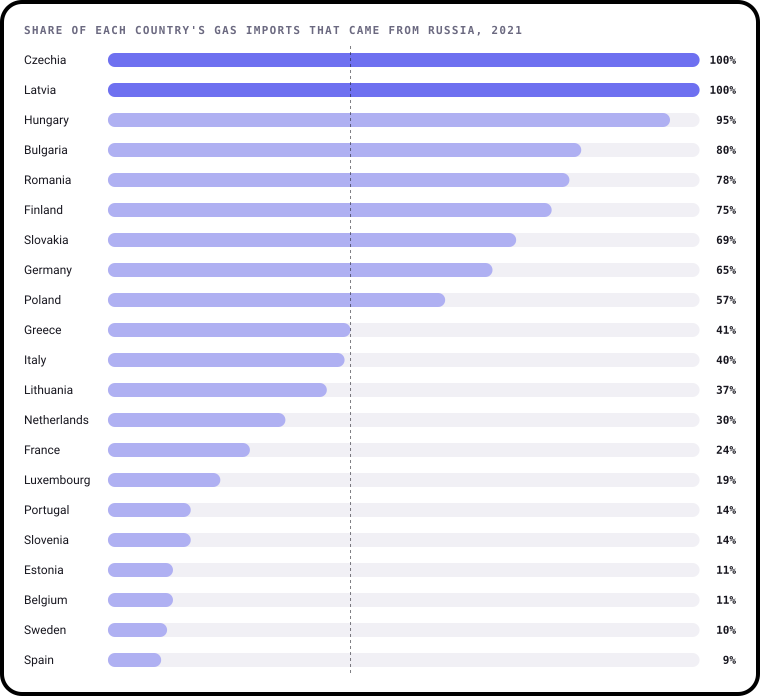

Countries that bought less than 500 million cubic metres of gas from abroad are left out, because a single delivery
can swing their figures. A few countries, including Austria, report no Russian gas at all, even though Austria is
known to have bought most of its gas from Russia. These figures depend on how each country records where its gas
came from, so treat the smaller bars with care.

Who filled the gap? Mostly Norway, through North Sea pipelines, and the United States, by ship. The EU imported
**17 billion cubic metres** of American LNG in 2021 and **55 billion cubic metres** in 2025.

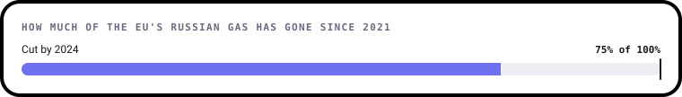

The last of it is now being legislated away. In January 2026 EU countries agreed a step-by-step ban: Russian LNG
from the start of 2027 and Russian pipeline gas from autumn 2027.

| When | What happened |
|---|---|
| 24 Feb 2022 | Russia invades Ukraine. European gas and oil prices jump within days. [↗](https://www.consilium.europa.eu/en/policies/ending-russian-energy-imports/) |
| 18 May 2022 | The European Commission launches REPowerEU, a plan to stop buying Russian fossil fuels. [↗](https://energy.ec.europa.eu/strategy/repowereu-phase-out-russian-energy-imports_en) |
| 26 May 2022 | The UK brings in the Energy Profits Levy: an extra 25% tax on oil and gas producers' profits. [↗](https://www.gov.uk/government/publications/energy-profits-levy-reforms-2024/energy-profits-levy-reforms-2024) |
| 26 Aug 2022 | European gas hits an all-time high of €319 per megawatt-hour on the Dutch TTF market. [↗](https://www.argusmedia.com/en/news-and-insights/market-opinion-and-analysis-blog/a-year-on-the-ttf-returns-from-the-stratosphere) |
| 26 Sep 2022 | Explosions wreck the Nord Stream pipelines under the Baltic Sea. [↗](https://www.osw.waw.pl/en/publikacje/analyses/2022-09-29/sabotage-nord-stream-1-and-nord-stream-2-pipelines) |
| 8 Oct 2022 | EU emergency rules take effect: a 'solidarity contribution' of at least 33% on fossil fuel firms' extra profits, and a €180 per MWh cap on some power producers' revenues. [↗](https://vinge.se/en/news/temporary-eu-measures-addressing-rising-energy-prices) |
| 19 Dec 2022 | EU countries agree a gas price cap: the market correction mechanism at €180 per MWh. [↗](https://www.enerdata.net/publications/daily-energy-news/eu-member-states-agree-eu180mwh-price-cap-gas.html) |
| 1 Jan 2025 | Russian gas stops flowing to Europe through Ukraine as the transit deal expires. [↗](https://www.thenationalnews.com/news/europe/2025/01/01/russian-gas-flows-to-europe-via-ukraine-halted-after-deal-expires/) |
| 26 Jan 2026 | EU countries give final approval to a step-by-step ban on Russian gas: LNG from the start of 2027, pipeline gas from autumn 2027. [↗](https://www.consilium.europa.eu/en/press/press-releases/2026/01/26/russian-gas-imports-council-gives-final-greenlight-to-a-stepwise-ban/) |
| 11 Oct 2026 | The United States announces an 'energy ceasefire' between Russia and Ukraine. Ukraine reports new Russian strikes within days. [↗](https://www.aljazeera.com/news/2026/10/11/trump-says-ukraine-russia-agree-to-energy-ceasefire-2) |

## 4. The 2022 price shock

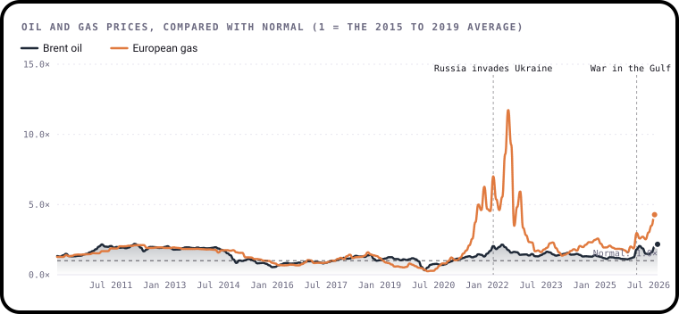

The line at 1 is normal: the average price from 2015 to 2019. Anything above it is how many times more expensive
energy was.

- **Gas** was already climbing in late 2021, as economies reopened after Covid and Russia sent less gas than usual.
  After the invasion of Ukraine it went further. In **Aug 2022** European gas cost **11.8 times** its normal
  price, the highest monthly average in this data.
- **Oil** rose too, but much less: about **2.1 times** normal at its 2022 peak. Oil is
  traded all over the world, so there are many more places to buy it. Most of Europe's gas came through a few
  pipelines.
- By 2024 gas had fallen back, but it never quite returned to normal. Even in 2025 it was about **2.0 times** its 2015 to 2019 level.

## 5. The second shock: war in the Gulf (2026)

On **28 February 2026** the United States and Israel struck Iran, and shipping through the **Strait of Hormuz**
almost stopped. This narrow channel between Iran and Oman carries about **20%** of
the world's oil and about **20%** of its LNG, including everything Qatar exports.

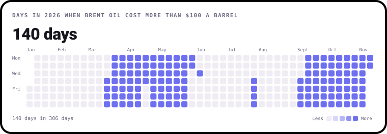

Each square is a day. A dark square means oil cost more than $100 a barrel that day. Markets are closed at weekends,
so weekends take the price from the last weekday before them.

- Oil cost more than $100 a barrel on **140 of the 306 days** so far this year, starting on
  12 March. Before the war, the last time it was over $100 was
  26 August 2022.
- On 27 February, just before the strikes, Brent oil cost **$71** a barrel.
- It peaked at **$138** on 7 April. A ceasefire in April and tankers moving again in June
  brought it back down. Then fighting started again at the end of August.
- In Oct 2026 oil averaged **$124**, the highest monthly average since
  Mar 2012, before allowing for inflation. The latest daily price, on
  3 November 2026, was **$107**.

This time Europe was hit through its gas storage. Countries fill underground stores over the summer to get through
the winter. They were unusually empty when the war began: at the end of February the EU held
**46 billion cubic metres**, against 60 a year earlier and 77 in 2024.

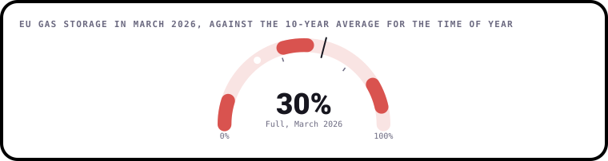

Storage was about **30%** full in March 2026, against a usual **58%** for the time of year. The
Commission told countries they could aim for 80% by winter instead of the legal 90%. By the
end of August, storage had only reached **64.7%**.

| When | What happened |
|---|---|
| 28 Feb 2026 | The United States and Israel strike Iran. Shipping through the Strait of Hormuz slows to a near standstill. [↗](https://www.bruegel.org/first-glance/how-will-iran-conflict-hit-european-energy-markets) |
| 2 Mar 2026 | QatarEnergy halts production at Ras Laffan after Iranian drone attacks. European gas prices jump 46% in a day, to €46.52 per MWh. [↗](https://www.rte.ie/news/business/2026/0302/1561275-gas-prices/) |
| 20 Mar 2026 | With storage only about 30% full, the Commission tells EU countries they can lower their gas storage target from 90% to 80%. [↗](https://www.euronews.com/2026/03/23/eu-pushes-early-gas-refills-while-easing-storage-targets-on-iran-war) |
| 8 Apr 2026 | A ceasefire is announced. Oil falls 13% in a day. [↗](https://en.wikipedia.org/wiki/2026%E2%80%932028_world_oil_market_chronology) |
| 22 Apr 2026 | The Commission relaxes state aid rules so governments can help households and industry with bills, and allows further windfall taxes. [↗](https://www.rte.ie/news/europe/2026/0422/1569473-energy-prices-europe/) |
| 24 Jun 2026 | Tankers move through the Strait of Hormuz again, and oil falls back to where it was in February. [↗](https://en.wikipedia.org/wiki/2026%E2%80%932028_world_oil_market_chronology) |
| 30 Aug 2026 | Fighting starts again. The strait is 'effectively closed', Qatar's LNG is still offline and European gas tops €70 per MWh. [↗](https://www.euronews.com/2026/08/31/european-gas-prices-spike-above-70-amid-renewed-middle-east-fighting) |
| 4 Nov 2026 | Brent oil falls back below $100 a barrel, after averaging $124 in October. [↗](https://www.ogj.com/general-interest/economics-markets/news/55418180/eia-sees-brent-near-100-bbl-through-yearend-2026-as-middle-east-supply-constraints-persist) |

## 6. What households pay

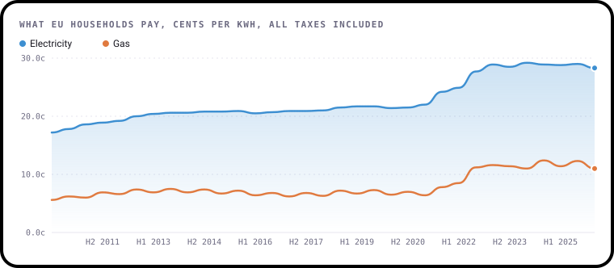

These are the prices households actually pay per kWh, including taxes, for a typical home. They are not adjusted
for inflation.

- Household **gas** rose **82%** between Jan to Jun 2021 and Jan to Jun 2023. It peaked at
  **12.4 cents** per kWh in Jul to Dec 2024, against **6.4 cents** in Jan to Jun 2021.
- Household **electricity** rose more slowly, but has stayed high: from **22.0 cents** in Jan to Jun 2021
  to a peak of **29.2 cents** in Jan to Jun 2024, up 32%.
- Bills moved much less than wholesale prices. Most homes pay fixed tariffs that change slowly, many governments
  capped prices, and taxes and network charges, which barely changed, make up a big part of every bill.
- The latest figures, for Jan to Jun 2026, only partly cover the war in the Gulf. If gas stays expensive, it will
  reach bills over the coming months.

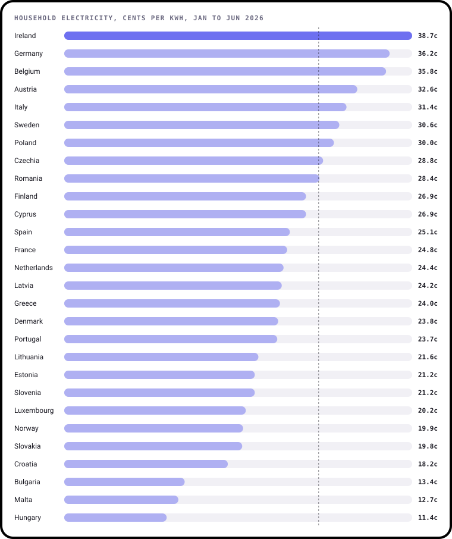

In Jan to Jun 2026, electricity was dearest in **Ireland (38.7 cents)** and cheapest in
**Hungary (11.4 cents)**. Hungary's government sets household prices well below market rates for
typical use, which is why it sits at the bottom.

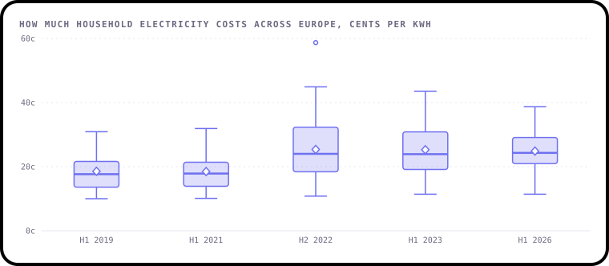

Each box shows the middle half of European countries, and the diamond marks the average. In 2022 the spread grew
much wider: some countries passed the shock on to households almost straight away, while others held prices down.

## 7. Did Russian gas decide who paid most?

You might expect the countries that bought the most Russian gas to have seen the biggest rises in bills. The data
says they didn't.

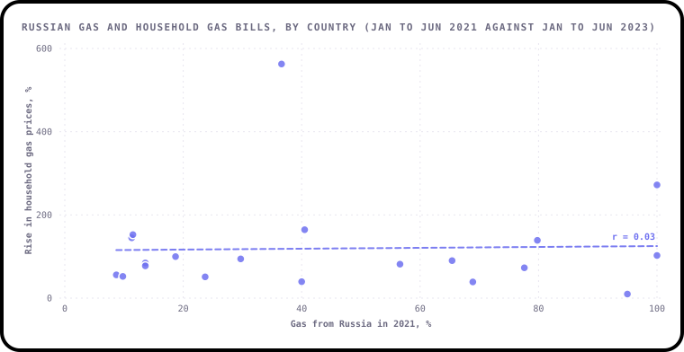

Each dot is a country. The dashed line is the best straight-line fit, and **r = 0.03** says how closely the dots
follow it. 1 would be a perfect upward line, and 0 means no pattern at all. Across these 20 countries,
there is almost no link.

The dot near the top is **Lithuania**, where household gas went up **563%**, from a very low
regulated price. Leave it out and r is still only **0.17**.

Why? Because Europe shares one gas market. When Russian gas disappeared, every country was suddenly bidding for the
same replacement cargoes, so prices rose everywhere, whether or not a country had ever bought from Russia. What
made the real difference to bills was what each government did next: price caps, tax cuts and subsidies.

## 8. Europe used less gas

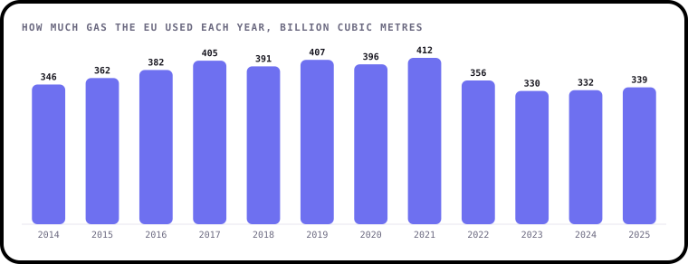

In August 2022 EU countries agreed to cut their gas use by 15%, compared with their usual use for the time of year.
It was voluntary, and later extended to March 2024.

- Between August 2022 and March 2024 the EU as a whole used **18%** less gas than usual. That's our
  calculation from Eurostat's monthly data, following the method set out in the EU rules. For the first winter alone,
  [Eurostat's own figure](https://ec.europa.eu/eurostat/web/products-eurostat-news/w/ddn-20230419-1) was 17.7%.
- In 2025 the EU used **339 billion cubic metres**, against **412 billion cubic metres** in 2021.
- Some of the cut came from people turning the heating down and from mild winters. A lot came from factories,
  especially chemicals and fertiliser makers, using less or shutting down production. That's a saving, but
  also a cost.

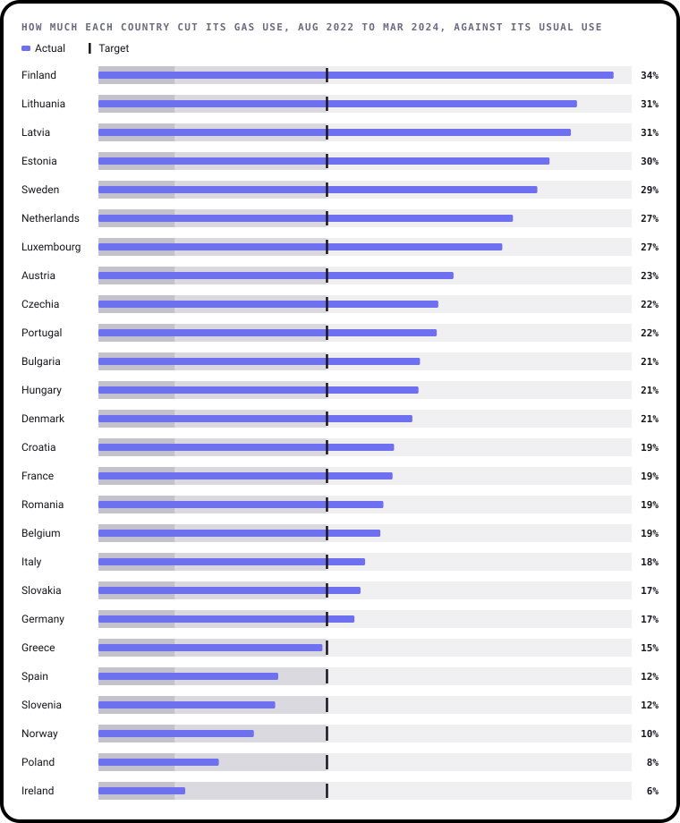

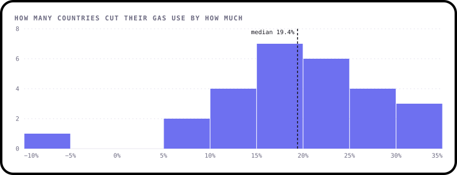

**20 of 27** countries beat the 15% goal. The typical country cut its use by about
**19%**. Malta used more gas than usual, so is left off the
first chart.

## 9. The switch to clean power

The shocks didn't just raise prices. They sped up a change that was already happening.

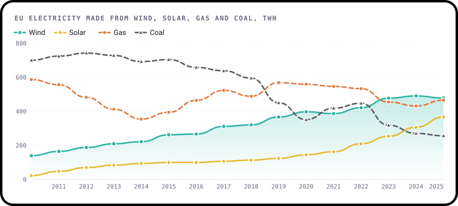

- **Wind** has made more of the EU's electricity than **gas** every year since **2023**.
- **Solar** overtook **coal** in **2024**. In 2010 coal made 29.9 times as much electricity as solar.

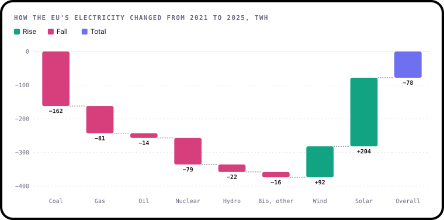

Between 2021 and 2025, coal power fell by **162 TWh** and gas power by
**81 TWh**. Solar grew by **204 TWh**, the biggest change of any source.
Overall the EU made **78 TWh** less electricity in 2025 than in 2021, partly because high
prices pushed people and businesses to use less.

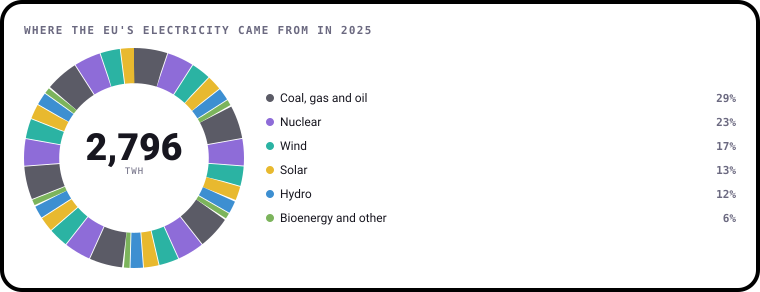

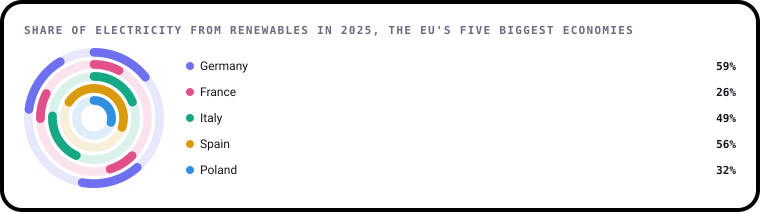

France scores lower on renewables than you might expect because most of its electricity comes from nuclear power,
which is low-carbon but not renewable.

## 10. What governments and the EU did

**Governments spent big to protect people.** Between September 2021 and January 2023, European governments set
aside about **€651 billion** to shield households and businesses from energy prices, according to
[Bruegel](https://www.bruegel.org/dataset/national-policies-shield-consumers-rising-energy-prices): **€540 billion** in the EU, **€103 billion** in
the UK and **€8.1 billion** in Norway. Germany alone earmarked **€158 billion**.
The help came as price caps, cuts to energy taxes, direct payments and support for businesses.

**The EU acted together**, which it had rarely done on energy:

| What | What it did |
|---|---|
| **Gas storage rules** (2022) | Countries must fill their gas stores to 90% before each winter. In 2026 this was eased to 80% because of the war in the Gulf |
| **15% cut in gas use** (Aug 2022) | A shared, voluntary goal, met overall: see finding 8 |
| **Windfall taxes** (Oct 2022) | A "solidarity contribution" of at least 33% on fossil fuel firms' extra profits, and a cap on some electricity producers' revenues |
| **Gas price cap** (Dec 2022) | A safety brake on the wholesale price at €180 per MWh |
| **REPowerEU** (May 2022) | The plan to end Russian fossil fuels: more renewables, more LNG terminals, saving energy |
| **Ban on Russian gas** (agreed Jan 2026) | No Russian LNG from 2027, no Russian pipeline gas from autumn 2027 |

**The UK** added its own windfall tax, the Energy Profits Levy, on oil and gas producers: 25% from
26 May 2022, raised to 35% from 1 January 2023 and 38% from
1 November 2024. It runs until 31 March 2030.

In April 2026, as the war in the Gulf pushed prices up again, the Commission relaxed the rules on state aid so
governments could help again, and said countries could tax windfall profits further.

## 11. The big energy companies

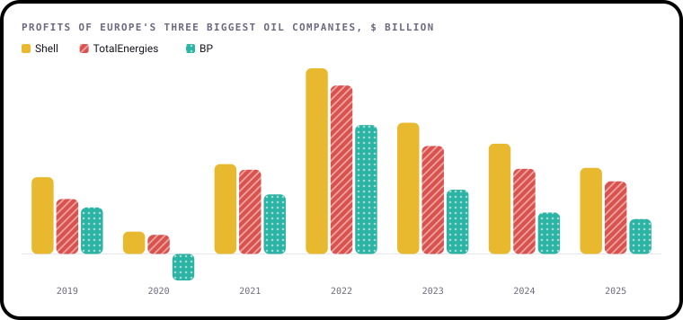

High prices were very good news for the companies that produce and sell oil and gas.

- In 2022 Shell, TotalEnergies and BP together made **$103.7 billion** in profit, against
  **$38.3 billion** in 2019. Shell's **$39.9 billion** was the biggest in its history.
- Profits have fallen back since: to **$41.6 billion** in 2025, as oil and gas prices eased.
- In 2020, the Covid year, BP made a loss of $5.7 billion.
- The profits fed the case for windfall taxes, and they shaped strategy. In February 2025 BP cut its yearly spending
  on low-carbon energy to $1.5 to $2 billion and raised its oil and gas spending to about $10 billion. Its chief executive said that "in the
  long run investors will love this".

Each company reports its own headline measure, which leaves out one-off gains and losses, so the figures are close
but not exactly like for like: Shell's adjusted earnings, TotalEnergies' adjusted net income and BP's underlying
replacement cost profit. Norway's Equinor, which sells much of the gas that replaced Russia's, also reported a record profit for 2022.

## About the data

| What | Who publishes it | File |
|---|---|---|
| Electricity by source, energy use | [Our World in Data](https://github.com/owid/energy-data), from Ember and the Energy Institute | [`energy_mix.csv`](../data/energy_mix.csv) |
| Household electricity and gas prices | [Eurostat](https://ec.europa.eu/eurostat/databrowser/view/nrg_pc_204/default/table?lang=en) | [`household_prices.csv`](../data/household_prices.csv) |
| Gas imports, by supplier | [Eurostat](https://ec.europa.eu/eurostat/databrowser/view/nrg_ti_gas/default/table?lang=en) | [`gas_imports_by_country.csv`](../data/gas_imports_by_country.csv), [`gas_imports.csv`](../data/gas_imports.csv) |
| Gas use, month by month | [Eurostat](https://ec.europa.eu/eurostat/databrowser/view/nrg_cb_gasm/default/table?lang=en) | [`gas_consumption.csv`](../data/gas_consumption.csv) |
| Oil price (Brent) | [U.S. Energy Information Administration, via FRED](https://fred.stlouisfed.org/series/MCOILBRENTEU) | [`world_prices.csv`](../data/world_prices.csv), [`brent_daily.csv`](../data/brent_daily.csv) |
| European gas price (Dutch TTF) | [International Monetary Fund, via FRED](https://fred.stlouisfed.org/series/PNGASEUUSDM) | [`world_prices.csv`](../data/world_prices.csv) |
| Company profits | Each company's annual results | [`company_profits.csv`](../data/company_profits.csv) |
| Events, storage, government support | Linked next to each figure | [`timeline.csv`](../data/timeline.csv), [`facts.json`](../data/facts.json) |

A few things to know:

- **Prices are not adjusted for inflation.** Everything else got more expensive too, especially in 2022 and 2023.
- **Gas imports by country of origin are only published yearly**, so the latest full year is 2024. Eurostat's
  monthly import figures record the country the gas arrived from, so Russian gas that crossed Ukraine shows up as
  Ukrainian, and Algerian gas as Tunisian. This report only uses them for American LNG, which arrives by ship.
- **The UK** left the EU in 2020, so Eurostat stopped publishing UK prices after that. The UK is included in the
  electricity figures from Our World in Data.
- **Countries sometimes keep figures confidential** or count gas by the neighbour it came through. Where that matters, it's
  said next to the chart.
